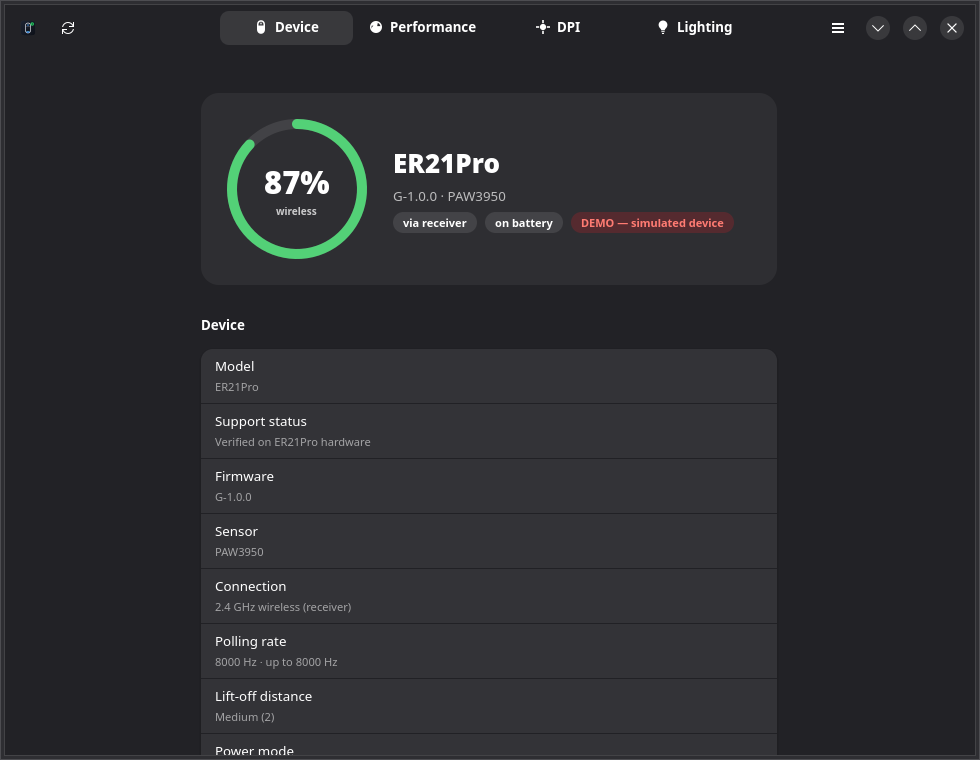
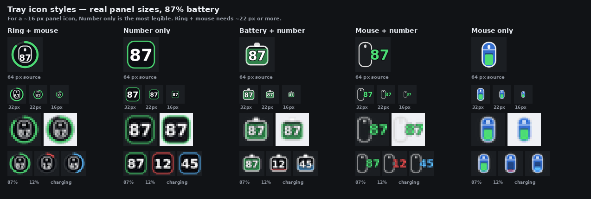
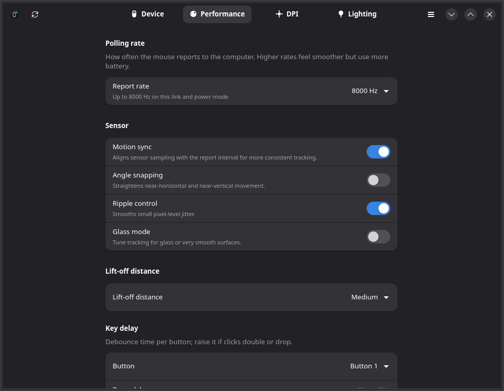
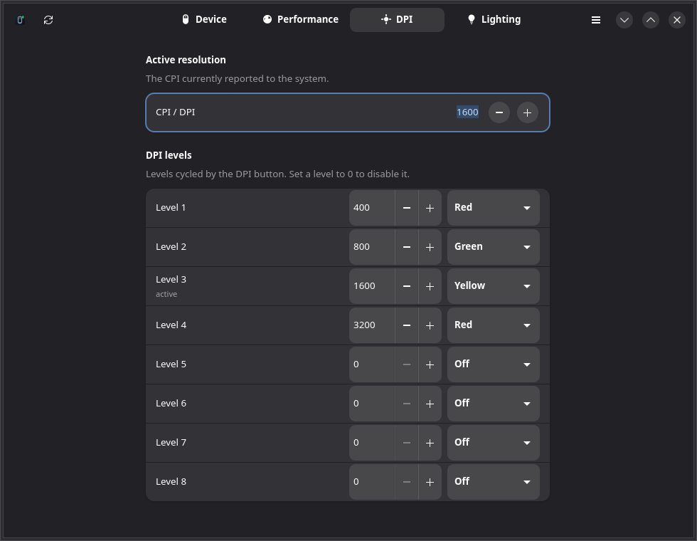

# RAWM Control

[](https://github.com/NasirA1991/rawm-control/actions/workflows/ci.yml)
[](https://github.com/NasirA1991/rawm-control/actions/workflows/release.yml)
[](https://aur.archlinux.org/packages/rawm-control)
[](https://aur.archlinux.org/packages/rawm-control-git)


Native **GTK4 / libadwaita** configuration for RAWM gaming mice on Linux — no
browser tab, no Windows VM, no vendor service.

RAWM only ships a WebHID driver (the *RAWM HUB* page) plus Windows/Android
clients. RAWM Control talks to the mouse's 64-byte vendor HID collection
directly, using a protocol recovered from that web driver. It was developed and
verified against an **ER21Pro** (`1915:2338`, firmware `G-1.0.0`, PAW3950),
both over its own link and through the **RAWM HS Receiver** (`1915:232b`).



<sub>Screenshots are rendered by the built-in demo mode (`--demo`).</sub>

## Features

- **Tray icon with live battery** — five selectable designs: *Ring + mouse*,
  *Number only*, *Battery + number*, *Mouse + number* and *Mouse only*. Pick one
  from the tray's **Tray icon** submenu; the choice is remembered. Number-only
  is the most readable on ~16 px panels. Charging state and connection type stay
  in the tooltip, with quick actions for polling rate, DPI, motion sync, angle
  snapping, refresh and quit.
- **Performance** — polling rate adapts to the link (1000 Hz wired/direct, up to
  8000 Hz through an 8K receiver; power-mode caps respected), motion sync,
  ripple control, angle snapping, angle tuning (−30°…+30°), lift-off distance
  with a surface-quality estimate, glass mode, power mode, sleep timer and
  wireless turbo.
- **DPI** — active CPI slider and eight DPI levels with per-level indicator
  colours.
- **Lighting** — DPI-colour indicator, static colour, off, and auto-off when idle.
- **Key delay** — per-button press/release debounce in milliseconds.
- **Hotplug** — detects the dongle, reconnects automatically, survives sleep.
- **CLI** (`rawmctl`) for scripts, keybinds and status bars.
- **Offline and private** — the official driver uploads telemetry
  (`mouse_config.php`); this app never phones home.






## Install

Release builds are produced by GitHub Actions and attached to every `v*`
release. Pick the format that matches your system:

| Format | Best for | What it bundles |
|---|---|---|
| **AUR** `rawm-control` / `rawm-control-git` | Arch, CachyOS, EndeavourOS | source; builds against your system |
| **Flatpak** `.flatpak` | any distro with Flatpak | GNOME runtime: Python, GTK4, libadwaita, PyGObject, dbus-python |
| **AppImage** `.AppImage` | quick run anywhere with GTK4 installed | the app only; host provides GTK4/PyGObject |
| **Source tarball** | packaging, auditing, hacking | source + install script |

### Arch / CachyOS (AUR)

```bash
yay -S rawm-control-git     # latest main, rebuilt on updates
yay -S rawm-control         # latest tagged release
```

Both are published: [rawm-control](https://aur.archlinux.org/packages/rawm-control)
· [rawm-control-git](https://aur.archlinux.org/packages/rawm-control-git).

The AUR packages install the udev rule, desktop entry and tray integration.

### Flatpak

Download `rawm-control-<version>-x86_64.flatpak` from the
[Releases page](https://github.com/NasirA1991/rawm-control/releases):

```bash
flatpak install --user ./rawm-control-0.1.1-x86_64.flatpak
flatpak run io.github.rawmcontrol.RawmControl
```

The Flatpak is fully self-contained and exposes `/dev/hidraw*` via
`--device=all`. If the mouse is not detected, make sure the host grants access
to the vendor HID collection (see [Permissions](#permissions)).

> The manifest is ready for building a bundle, but this repository does **not**
> publish to Flathub. Flathub has its own review and policy requirements; a
> self-hosted `.flatpak` on GitHub Releases is the supported path here.

### AppImage

Download `rawm-control-<version>-x86_64.AppImage`, then:

```bash
chmod +x rawm-control-0.1.1-x86_64.AppImage
./rawm-control-0.1.1-x86_64.AppImage
```

The AppImage intentionally bundles only the application. It uses the host's
Python 3, PyGObject, GTK4, libadwaita, pycairo and dbus-python. Install them
with:

```bash
# Arch / CachyOS
sudo pacman -S python-gobject gtk4 libadwaita python-cairo python-dbus hicolor-icon-theme
# Debian / Ubuntu
sudo apt install python3-gi gir1.2-gtk-4.0 gir1.2-adw-1 python3-cairo python3-dbus hicolor-icon-theme
# Fedora
sudo dnf install python3-gobject gtk4 libadwaita python3-cairo python3-dbus hicolor-icon-theme
```

A fully self-contained bundle is the Flatpak above; AppImage cannot reliably
bundle PyGObject/GTK4 without shipping a very large, fragile tree. The release
AppImage was smoke-tested on CachyOS.

### From source

Dependencies: `python python-gobject gtk4 libadwaita python-cairo python-dbus
hicolor-icon-theme`.

```bash
git clone https://github.com/NasirA1991/rawm-control.git
cd rawm-control
./rawm-control --demo          # preview, no mouse required
python3 -m rawm_control        # run from the checkout
sudo ./install.sh              # /usr; installs the udev rule and desktop entry
# or:
./install.sh --user            # ~/.local, no root (udev rule separate)
```

or build a local Arch package:

```bash
makepkg -si
```

## Permissions

The vendor HID collection is `/dev/hidrawN`, usually `root:root` with a udev
`uaccess` ACL. For system installs the packaged rule is installed
automatically:

```
SUBSYSTEM=="hidraw", ATTRS{idVendor}=="1915", TAG+="uaccess", MODE="0660"
```

For AppImage/Flatpak or a source run without `sudo ./install.sh`, install it
manually:

```bash
sudo install -m644 data/udev/71-rawm-hid.rules /usr/lib/udev/rules.d/
sudo udevadm control --reload-rules && sudo udevadm trigger
# then unplug/replug the receiver
```

## Usage

```bash
rawm-control                # window + tray
rawm-control --tray         # start minimized
rawm-control --no-tray      # window only
rawm-control --demo         # simulated ER21Pro, no hardware
```

Close the window to keep it running in the tray; **Quit** from the tray menu
(or `Ctrl+Q`) exits.

### CLI

```bash
rawmctl status
rawmctl polling 8000
rawmctl motion-sync on
rawmctl angle-snapping off
rawmctl ripple-control on
rawmctl dpi 1600
rawmctl lod 2
rawmctl power HP
rawmctl sleep 5
rawmctl scan
rawmctl caps
rawmctl status --json
```

Setters re-query the mouse and exit non-zero if the device did not confirm the
change, so they are safe to use in scripts.

### Tray on GNOME

GNOME needs an AppIndicator/StatusNotifier extension (for example
*AppIndicator and KStatusNotifierItem Support*). KDE Plasma, XFCE, sway/waybar
and other SNI hosts work out of the box. Flatpak apps need the usual session-bus
access, which the manifest already declares.

## Supported devices

The protocol is shared across the current RAWM family. The bundled capability
table comes from the vendor's own device database. **Hardware verification so
far is limited to the ER21Pro** (direct and through an HS Receiver); the other
rows are supported by the capability database and the same protocol, but have
not been tested on physical units. Reports with model, PID and firmware are
very welcome.

| Model | USB ID | Direct / own dongle | With 8K receiver |
|-------|--------|--------------------:|-----------------:|
| ER21 | 1915:233f | 1000 Hz | 8000 Hz |
| ER21M | 1915:2339 | 1000 Hz | 8000 Hz |
| ER21Pro | 1915:2338 | 1000 Hz | 8000 Hz |
| ES11 | 1915:2341 | 1000 Hz | 8000 Hz |
| ES21 | 1915:2333 | 1000 Hz | 8000 Hz |
| ES21M | 1915:2337 | 1000 Hz | 8000 Hz |
| ES21Pro | 1915:2352 / 2349 / 2334 | 1000 Hz | 8000 Hz |
| G11 | 1915:233a | 1000 Hz | 2000 Hz |
| G11Plus | 1915:2343 | 1000 Hz | 2000 Hz |
| G11Pro | 1915:2344 | 1000 Hz | 8000 Hz |
| LEVIATHAN V4 | 1915:234a | 8000 Hz | 8000 Hz |
| SA-MH01 | 1915:232c | 1000 Hz | 8000 Hz |
| SA-MH01Pro | 1915:2331 | 1000 Hz | 8000 Hz |
| SA-ML01 | 1915:2329 | 1000 Hz | 8000 Hz |
| SA-SH01 | 1915:232e | 1000 Hz | 8000 Hz |
| SA-SH01Pro | 1915:2332 | 1000 Hz | 8000 Hz |
| SA-SH01S | 1915:233e | 1000 Hz | 8000 Hz |
| SA-SL01 | 1915:232d | 1000 Hz | 8000 Hz |
| SA-SL01C | 1915:2340 | 1000 Hz | 2000 Hz |
| SADES Dagger | 1915:2348 | 1000 Hz | 8000 Hz |
| RAWM Knife | 1915:2328 | 1000 Hz | 8000 Hz |

“Direct / own dongle” is what the mouse advertises without a separate receiver;
“With 8K receiver” is what the vendor driver adds from a compatible dongle
(e.g. **RAWM HS Receiver `1915:232b`**). The effective maximum also depends on
the receiver model and power mode: **Office = 125 Hz, LP = 1000 Hz**, while
HP/Gaming+ allow the table maximum. The app shows the current rate **and** the
maximum for the current link (`rawmctl status` line: `polling 1000 Hz (max
8000 Hz)`).

**Receiver dongles are supported.** A dongle such as the *RAWM HS Receiver*
(`1915:232b`) describes itself on the direct link; the paired mouse is a virtual
client on ESB channel 0. RAWM Control wraps packets in the extended-channel
header, queries the mouse through the dongle, and writes settings back the same
way. Verified with an HS Receiver + ER21Pro. If the mouse is asleep the app
shows a retry banner instead of inventing values.

Unknown PIDs get a generic UI with conservative defaults. `rawmctl scan` lists
receivers and their paired mouse.

## Troubleshooting

- **"permission denied"** — install the udev rule above and replug the receiver.
- **"Receiver connected, but the paired mouse is asleep"** — move the mouse or
  turn it on; the app retries automatically.
- **Settings don't stick / flapping** — close the official RAWM HUB browser tab
  or vendor app; two configurators writing at once fight.
- **No tray icon on GNOME** — install an AppIndicator/KStatusNotifierItem
  extension.
- **AppImage won't start** — install the GTK4/PyGObject dependencies above, or
  use the Flatpak.
- **Tray submenu doesn't open on KDE** — use a build from this repository; the
  DBusMenu `AboutToShow` contract is required and was fixed in 0.1.0.

## Development

```bash
python3 -m unittest discover -s tests -v
RAWM_HW_TEST=1 python3 -m unittest tests.test_hardware -v
./packaging/appimage/build.sh 0.1.1 dist
./packaging/flatpak/build.sh 0.1.1 dist
```

`tools/` contains the reverse-engineering helpers:

- `tools/deob.js` — rebuilds the web driver's shuffled string table and
  substitutes all decoder calls.
- `tools/rawm_proto.py` — protocol playground (scan, query, frame dump).
- `tools/tray_mockups.py` / `tools/tray_styles.py` — tray icon renders.

## Releases, AUR and builds

[`.github/workflows/ci.yml`](.github/workflows/ci.yml) runs the tests;
[`.github/workflows/release.yml`](.github/workflows/release.yml) builds the
source tarball, AppImage, Flatpak bundle and publishes the GitHub release;
[`.github/workflows/aur-git.yml`](.github/workflows/aur-git.yml) updates
`rawm-control-git`.

In addition, every push to `main` builds an **edge** AppImage and Flatpak
(`.github/workflows/build.yml`) and refreshes the prerelease tagged `edge` on the
Releases page. Tagged `v*` releases are the stable artifacts.

See [docs/GITHUB_AUR.md](docs/GITHUB_AUR.md) for the one-time GitHub/AUR secret
setup and [docs/DISTRIBUTION.md](docs/DISTRIBUTION.md) for the packaging
details and per-format limitations.

## How it works

```
GTK4 UI ──► DeviceWorker (thread) ──► /dev/hidrawN (vendor HID, 64-byte reports)
                     │                        │
                     └── FrameStream ◄────────┘  FF FF FF FF + frame
```

- `rawm_control/protocol.py` — framing, CRC16, query parsing, parameter block,
  discovery, hidraw transport.
- `rawm_control/worker.py` — owns the fd, coalesces writes, emits state,
  reconnects.
- `rawm_control/tray.py` — StatusNotifierItem + DBusMenu on raw DBus (no GTK3),
  cairo-drawn icons.
- `rawm_control/devices.py` + `data/devices.json` — per-model capabilities.
- [docs/PROTOCOL.md](docs/PROTOCOL.md) — complete protocol write-up.

## Not implemented yet

- Key remapping (Key/Macro/Function/None), the R-Plus secondary layer, onboard
  profile editor with Restore / Apply & onboard.
- X/Y-linked DPI, the X-Polling free-rate slider, RF channel selection and the
  2.4 GHz optimization test.
- Lighting Loop/Customize modes and switchable receiver LEDs.
- Brightness and firmware update / DFU.

The wire protocol for most of these is documented in
[docs/PROTOCOL.md](docs/PROTOCOL.md); they need UI and verification work.

## Disclaimer

This is an independent project. It is not affiliated with, endorsed by or
supported by RAWM or MiraclTek. The protocol was recovered from the publicly
served RAWM HUB web driver; no vendor code is included. Changing device settings
writes to the mouse's firmware-managed configuration — use at your own risk.

## License

MIT. See [LICENSE](LICENSE).
