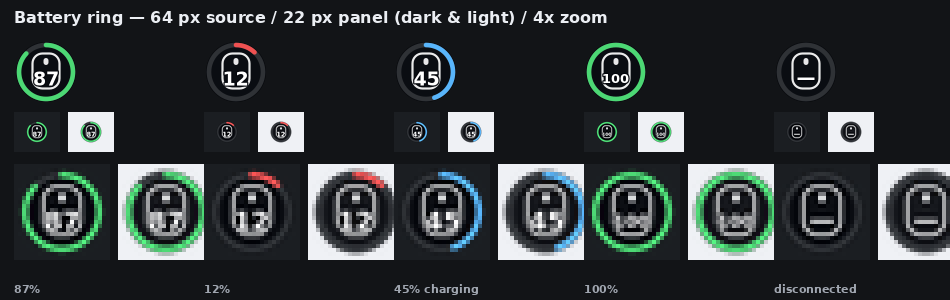
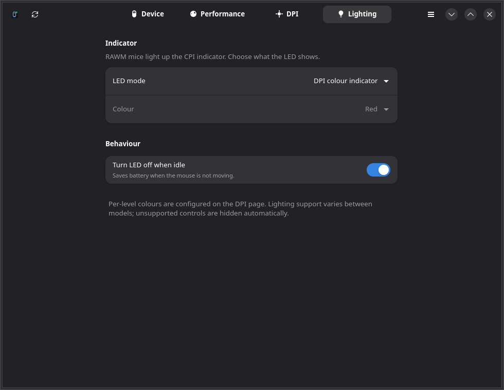

# RAWM Control

Native **GTK4 / libadwaita** configuration for RAWM gaming mice on Linux — no
browser tab, no Windows VM, no vendor service.

RAWM only ships a WebHID driver (the *RAWM HUB* page) plus Windows/Android
clients. RAWM Control talks to the mouse's 64-byte vendor HID collection
directly, using a protocol recovered from that web driver. It was developed and
verified against an **ER21Pro** (`1915:2338`, firmware `G-1.0.0`, PAW3950).


<sub>Screenshots are rendered by the built-in demo mode (`--demo`).</sub>

## Features

- **Tray icon with live battery** — a battery ring around a mouse glyph with the
  percentage drawn inside (colour-coded: green / yellow / red, blue while
  charging), on a dark backing disc so it stays legible on light and dark
  panels. Charging state and connection type stay in the tooltip. Toggle the
  ring from the tray menu ("Show battery % on icon") or the main menu to get the
  plain mouse glyph back. Quick actions: polling rate, DPI, motion sync, angle
  snapping, open, quit.

- **Performance** — polling rate adapts to the link (1000 Hz wired/direct, up to
  8000 Hz through an 8000 Hz-capable receiver; power-mode caps respected), motion sync,
  ripple control, angle snapping, angle tuning (−30°…+30°), lift-off distance
  with a surface-quality estimate, glass mode, power mode, sleep timer and
  wireless turbo.
- **DPI** — active CPI slider and eight DPI levels with per-level indicator
  colours.
- **Lighting** — DPI-colour indicator, static colour, off, and auto-off when idle.
- **Key delay** — per-button press/release debounce in milliseconds.
- **Hotplug** — detects the dongle, reconnects automatically, survives sleep.
- **CLI** (`rawmctl`) for scripts, keybinds and status bars.
- **Offline and private** — the official driver uploads telemetry
  (`mouse_config.php`); this app never phones home.






## Supported devices

The protocol is shared across the current RAWM family. The bundled capability
table (from the vendor's own device database) covers:

| Model | USB ID | Polling |
|-------|--------|---------|
| ER21 / ER21M / ER21Pro | 1915:233f / 2339 / **2338** | 125–1000 Hz |
| ES21 / ES21M / ES21Pro | 1915:2333 / 2337 / 2334, 2352 | 125–1000 Hz |
| ES11 | 1915:2341 | 125–1000 Hz |
| G11 / G11Plus / G11Pro | 1915:233a / 2343 / 2344 | 125–1000 Hz |
| SA-ML01 / SA-MH01 / SA-SH01 / SA-SL01 | 1915:2329 / 232c / 232e / 232d | 125–1000 Hz |
| SA-MH01Pro / SA-SH01Pro / SA-SH01S | 1915:2331 / 2332 / 233e | 125–1000 Hz |
| SA-SL01C | 1915:2340 | 125–1000 Hz |
| LEVIATHAN V4 | 1915:234a | 125–8000 Hz |
| SADES Dagger | 1915:2348 | 125–1000 Hz |
| RAWM Knife | 1915:2328 | 125–1000 Hz |

**Receiver dongles are supported.** A dongle such as the *RAWM HS Receiver*
(`1915:232b`) only describes itself on the direct link; the paired mouse is a
virtual client on Nordic ESB channel 0. RAWM Control wraps packets in the
extended-channel header, queries the mouse through the dongle, and writes
settings back the same way. Verified with an HS Receiver + ER21Pro (writes and
confirmation). If the mouse is asleep the app shows a retry banner instead of
inventing values.

Unknown PIDs still get a generic UI with conservative defaults. Run
`rawmctl scan` to see receivers and their paired mouse.

## Install

### Arch / CachyOS (PKGBUILD)

Dependencies: `python python-gobject gtk4 libadwaita python-cairo python-dbus
hicolor-icon-theme`.

```bash
makepkg -si          # builds and installs the local package
```

### Any distro (manual)

```bash
sudo ./install.sh             # /usr, installs the udev rule
./install.sh --user           # ~/.local, no root
```

`install.sh` installs the launcher, icons, desktop entry, metainfo and the udev
rule. For the per-user install, add `--user` and install the udev rule yourself
if necessary (see below).

### Permissions

The vendor interface is `/dev/hidraw*` owned by `root:root`. The packaged udev
rule grants the logged-in user access:

```
SUBSYSTEM=="hidraw", ATTRS{idVendor}=="1915", TAG+="uaccess", MODE="0660"
```

Install it without the script:

```bash
sudo install -m644 data/udev/71-rawm-hid.rules /usr/lib/udev/rules.d/
sudo udevadm control --reload-rules && sudo udevadm trigger
# unplug and replug the dongle
```

## Usage

```bash
rawm-control                # open the window + tray
rawm-control --tray         # start minimized in the tray
rawm-control --no-tray      # window only
rawm-control --demo         # simulated ER21Pro, no hardware needed
```

Close the window to keep it running in the tray; **Quit** from the menu (or
`Ctrl+Q`) exits.

### CLI

```bash
rawmctl status
rawmctl polling 1000
rawmctl motion-sync on
rawmctl angle-snapping off
rawmctl ripple-control on
rawmctl dpi 1600
rawmctl lod 2
rawmctl power HP
rawmctl sleep 5
rawmctl scan
rawmctl caps
```

Every setter re-queries the mouse and exits non-zero if the device did not
confirm the change, which makes it safe to use in scripts.

### Tray on GNOME

GNOME needs an AppIndicator/StatusNotifier extension (for example *AppIndicator
and KStatusNotifierItem Support*). KDE Plasma, XFCE, sway/waybar and other SNI
hosts work out of the box. If no StatusNotifierWatcher exists the app silently
runs window-only.

## Troubleshooting

- **"permission denied"** — the udev rule is missing or the mouse needs a
  replug: `sudo install -m644 data/udev/71-rawm-hid.rules /usr/lib/udev/rules.d/
  && sudo udevadm control --reload-rules && sudo udevadm trigger`.
- **"Receiver connected, but the paired mouse is asleep"** — move the mouse or
  turn it on; the app retries automatically and the banner clears.
- **Settings don't stick / flapping** — close the official RAWM HUB browser tab
  or the vendor app; two configurators writing at once will fight.
- **No tray icon on GNOME** — install an AppIndicator/KStatusNotifierItem
  extension.

## Configuration reference

See [docs/PROTOCOL.md](docs/PROTOCOL.md) for the full wire format, the JSON
query schema, the `CONFIG_TYPE_MOUSE_PARAM` layout, the CRC envelope and the
notification list.

## How it works

```
GTK4 UI ──► DeviceWorker (thread) ──► /dev/hidrawN (vendor HID, 64-byte reports)
                     │                        │
                     └── FrameStream ◄────────┘  FF FF FF FF + frame
```

- `rawm_control/protocol.py` — framing, CRC16, query parsing, parameter block,
  discovery, hidraw transport.
- `rawm_control/worker.py` — owns the fd, coalesces writes, emits state to the
  UI, reconnects on hotplug.
- `rawm_control/ui.py` — libadwaita pages.
- `rawm_control/tray.py` — StatusNotifierItem + DBusMenu implemented on raw
  DBus (no GTK3 in the GTK4 process), with a cairo-drawn battery icon.
- `rawm_control/devices.py` + `data/devices.json` — per-model capabilities.

## Development

```bash
git clone <this repository>
cd RAWMLinuxApp
python3 -m rawm_control status     # no install needed
python3 -m unittest discover -s tests -v
RAWM_HW_TEST=1 python3 -m unittest tests.test_hardware -v
```

`tools/` contains the reverse-engineering helpers:

- `tools/deob.js` — rebuilds the web driver's shuffled string table and
  substitutes all 9,062 decoder calls.
- `tools/rawm_proto.py` — standalone protocol playground (scan, query, frame
  dump).
- `tools/probe.py`, `tools/sendtest.py`, `tools/test_write.py` — the probes used
  to determine the report header, resync marker and write path.

## Not implemented yet

- Key remapping (Key/Macro/Function/None), the R-Plus secondary layer, and the
  onboard-profile editor with Restore / Apply & onboard
- X/Y-linked DPI (the capability table only enables it for models that expose
  `cpi_xy`), the X-Polling free-rate slider, and switching between 2 / 40 / 80
  RF channels or running the 2.4 GHz optimization test
- Lighting Loop/Customize modes and the receiver's switchable colour LEDs
- Brightness and firmware update / DFU

The wire protocol for most of these is already documented in
[docs/PROTOCOL.md](docs/PROTOCOL.md); they need UI and verification work rather
than more reverse engineering.

## Disclaimer

This is an independent project. It is not affiliated with, endorsed by or
supported by RAWM or MiraclTek. The protocol was recovered from the publicly
served RAWM HUB web driver; no vendor code is included. Changing device settings
writes to the mouse's firmware-managed configuration — use at your own risk.

## License

MIT. See [LICENSE](LICENSE).


## Releases and the AUR

The repository ships GitHub Actions for CI, tagged GitHub releases, and AUR
publishing of both `rawm-control` (stable, on `v*` tags) and `rawm-control-git`
(tracks `main`). See [docs/GITHUB_AUR.md](docs/GITHUB_AUR.md) for the one-time
GitHub/AUR secret setup and the release checklist.
